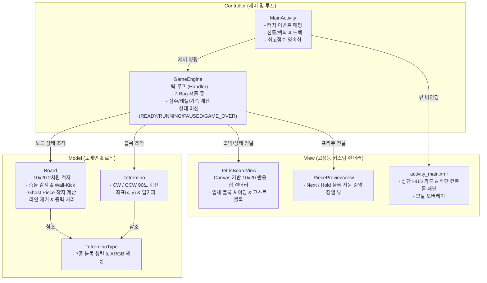

# 🕹️ AGY Tetris (Mobile Android Tetris)

안드로이드 네이티브(Java) 기반으로 구현된 고성능 아케이드 스타일의 모바일 테트리스 게임입니다.  
국제 테트리스 가이드라인(7-Bag Randomizer, Ghost Piece, Hold 시스템, Wall-Kick)을 충실히 준수하며, 모바일 터치 환경에 최적화된 반응형 UI와 햅틱 피드백을 제공합니다.

---

## 📸 주요 기능 및 특징 (Key Features)

- **7가지 표준 테트로미노 & 네온 아케이드 스타일**:
  - `I`, `J`, `L`, `O`, `S`, `T`, `Z` 7가지 블록 고유 색상 및 입체 하이라이트/그림자 셰이딩 렌더링
- **7-Bag Randomizer**:
  - 7개 블록이 한 세트로 무작위 셔플되어 특정 블록만 반복되거나 오랫동안 나오지 않는 현상을 원천 방지
- **고스트 피스 (Ghost Piece)**:
  - 현재 블록이 수직 낙하할 경우 착지할 지점을 반투명 윤곽선으로 미리 투영 표시
- **역동적인 화면 흔들림 (Screen Shake Effect)**:
  - 줄을 제거할 때 제거된 줄 수(1~4줄)에 비례하여 강도가 달라지는 화면 흔들림 및 회전 틸트 효과 적용 (4줄 테트리스 클리어 시 강렬한 아케이드 타격감 제공)
- **홀드 시스템 (Hold System)**:
  - 현재 블록을 저장하거나 보관된 블록과 교체 가능 (블록 낙하당 1회 제한)
- **벽 킥 (Wall Kick) 지원**:
  - 벽면이나 다른 블록 근처에서 회전 시 적절한 오프셋을 자동 적용하여 쾌적한 조작감 제공
- **점수 및 레벨별 가속 시스템**:
  - 싱글(100), 더블(300), 트리플(500), 테트리스(800) 점수 체계
  - 10줄을 제거할 때마다 레벨업 및 낙하 속도 점진적 가속 (최대 레벨 도달 시 초고속 아케이드 모드)
- **모바일 맞춤 컨트롤 & 햅틱 피드백**:
  - 직관적인 좌/우/소프트드롭 D-Pad
  - 시계 방향(`⟳`) / 반시계 방향(`⟲`) 회전 분리
  - 즉시 착지 `⚡ DROP` (Hard Drop) 버튼
  - 블록 착지, 하드 드롭, 라인 클리어, 게임오버 상황별 맞춤 진동 효과
- **최고 점수 저장 (High Score Persistence)**:
  - `SharedPreferences`를 활용하여 앱을 종료하거나 재부팅해도 역대 최고 점수(`BEST`) 영구 보존
- **게임오버 & 일시정지 오버레이**:
  - 게임 플레이 중 일시정지(`⏸`) 및 재개/재시작
  - 게임오버 시 최종 스코어 및 신기록(`NEW RECORD!`) 달성 뱃지 표시

---

## 🏛️ 아키텍처 및 프로젝트 구조 (Architecture)

프로젝트는 유지보수성과 확장성을 위해 **MVC (Model-View-Controller)** 구조로 설계되었습니다.



### 디렉터리 구성
```text
app/src/main/
├── AndroidManifest.xml                         # 세로 화면 고정 및 진동 권한 설정
├── java/com/example/agytetris/
│   ├── MainActivity.java                       # 메인 컨트롤러, 생명주기 및 햅틱 제어
│   ├── engine/
│   │   └── GameEngine.java                     # 게임 루프, 7-Bag, 점수/레벨 시스템
│   ├── model/
│   │   ├── Board.java                          # 10x20 보드, 충돌 검사, 라인 클리어, Ghost 연산
│   │   ├── Tetromino.java                      # 블록 인스턴스, 회전 및 위치 관리
│   │   └── TetrominoType.java                  # 7종 테트로미노 정의 및 ARGB 색상
│   └── view/
│       ├── TetrisBoardView.java                # 메인 보드 커스텀 Canvas 렌더러
│       └── PiecePreviewView.java               # Hold/Next 블록 전용 프리뷰 뷰
└── res/
    ├── drawable/                               # 맞춤형 카드 및 네온 조작 버튼 리소스
    ├── layout/activity_main.xml                # HUD, 3분할 플레이필드, D-Pad, 오버레이
    └── values/                                 # 다크 아케이드 컬러, 테마, 문자열 리소스
```

---

## 🎮 조작법 가이드 (Controls)

| 버튼 | 기능 | 설명 |
| :---: | :---: | :--- |
| **`◀`** / **`▶`** | 좌/우 이동 | 블록을 좌우로 한 칸씩 이동합니다. |
| **`▼`** | 소프트 드롭 | 블록을 아래로 1칸 빠르게 낙하하며 1점을 획득합니다. |
| **`⚡ DROP`** | 하드 드롭 | 즉시 바닥으로 착지시키며 낙하 거리에 비례하여 점수를 획득합니다. |
| **`⟳`** / **`⟲`** | 시계 / 반시계 회전 | 블록을 90도 회전시킵니다. (벽 킥 지원) |
| **`HOLD`** | 블록 보관/교체 | 현재 블록을 보관하거나 보관된 블록과 교체합니다. (1회 제한) |
| **`⏸`** | 일시정지 | 게임을 일시정지하고 재개/재시작 메뉴를 엽니다. |

---

## 🧪 빌드 및 테스트 (Build & Test)

### 요구 사양
- **Android Studio**: Ladybug / Meerkat 이상 권장
- **JDK**: Java 11 이상
- **Android SDK**: `minSdk 24` (Android 7.0) ~ `targetSdk 36` (Android 16)

### 빌드 및 실행 명령어
```bash
# 디버그 APK 빌드
./gradlew assembleDebug

# 단위 테스트 실행
./gradlew testDebugUnitTest
```

### 단위 테스트 항목 ([`TetrisLogicTest.java`](file:///C:/Users/PC/AndroidStudioProjects/AGYTetris/app/src/test/java/com/example/agytetris/TetrisLogicTest.java))
- [x] 7개 테트로미노 형태 및 고유 ARGB 색상 유효성 검증
- [x] 4회 연속 90도 회전 시 원래 형태로 정확히 복귀하는지 검증
- [x] 좌/우/바닥 격자 경계선 충돌 판정 검증
- [x] 채워진 행 탐색, 삭제 및 상단 행들의 중력 낙하 정합성 검증
- [x] 착지 위치를 예측하는 고스트 피스(Ghost Piece) 좌표 계산 검증

---

## 📜 변경 및 커밋 로그 (Commit History)

- **`90c92e2`**: `first commit` (기본 README.md 및 저장소 초기화)
- **`763fe1e`**: `Initialize Android Tetris project structure and standard gitignore` (안드로이드 표준 .gitignore 적용 및 프로젝트 베이스 커밋)
- **`8551c4c`**: `Implement full native Android Tetris game (Engine, Custom Canvas Views, UI controls, Tests)` (테트리스 핵심 엔진, 커스텀 뷰, 컨트롤러, 단위 테스트 전체 구현)
